# 📊 Análisis de Cadena de Cafeterías Moka&Co.

## 📝 Descripción del Proyecto
Este proyecto consiste en un dashboard interactivo desarrollado en Power BI para la cadena de cafeterías "MOKA & CO." Su propósito principal es transformar los datos transaccionales del negocio en información estratégica que facilite la toma de decisiones basada en datos.
El panel de control proporciona una vista integral de la situación de la empresa al unificar el análisis en cuatro pilares clave: el rendimiento financiero (ventas totales, ingresos por año y crecimiento mensual), la eficiencia operativa (distribución de órdenes por turno y tiempos de servicio), el comportamiento del catálogo (productos más populares y ventas por subcategorías) y el perfilamiento del cliente (lealtad por membresía, demografía por género y métricas de satisfacción general).

## 🎯 Objetivos
- Objetivo 1: Identificar los productos y categorías de productos más rentables y con mayor volumen de salida.
- Objetivo 2: Analizar la tendencia de ventas a lo largo del periodo de datos.
- Objetivo 3: Medir la satisfacción y experiencia del cliente.
- Objetivo 4: Optimizar el menú basado en el rendimiento de los productos.
- Objetivo 5: Comprender el perfil y la lealtad de los consumidores.

## 📂 Fuente de Datos
- **Origen:** Cafe Dataset - Kaggle
- **Descripción:** El dataset incluye registros transaccionales de la cafetería, lo que permite extraer valor sobre pedidos, fechas, precios, categorías y reviews de los productos vendidos.

## 🛠️ Herramientas y Tecnologías
- Power BI Desktop
- Power Query (Extracción, Transformación y Carga - ETL)
- DAX (Modelado y cálculos avanzados)

## ⚙️ Proceso de Desarrollo
1. **Limpieza y Transformación (Power Query):**  Se normalizaron los formatos de datos y se extrajeron las tablas de Detalle de Órdenes y Sucursales para estructurar el esquema en copo de nieve. Además, se agregaron columnas condicionales para optimizar el cálculo de métricas y facilitar los filtros dinámicos del dashboard.
2. **Modelado de Datos:** Implementación de un esquema en copo de nieve con 5 tablas de dimensiones maestras (clientes, menú, empleados, sucursales y calendario) y 3 tablas de hechos (órdenes, detalles de venta y reseñas)..

3. **Cálculos Dax:** Se crearon medidas para las métricas clave:
   - VentasUSD: Calcula el ingreso total generado por las ventas.
        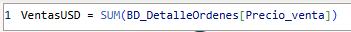
   - Espera_prom: Mide el tiempo promedio que tarda un cliente en recibir su orden.
        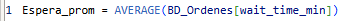
   - Estado_Servicio: Calcula si el tiempo de servicio es lento, al exceder los 14 minutos. 
        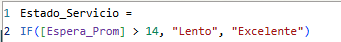
   - Items_Vendidos: Calcula el número de productos vendidos.
        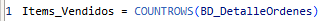
   - Reseñas_Positivas: Calcula el porcentaje de reseñas positivas de la cafetería
         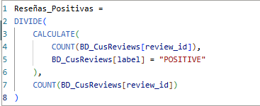
   - VentasUSD-1: Calcula el ingreso total de ventas con respecto al mes anterior, para medir la evolución y el crecimiento     mensual.
        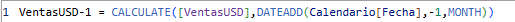

## 📈 Visualizaciones Clave
- **Ventas por años:** Muestra la evolución de los ingresos por ventas.
        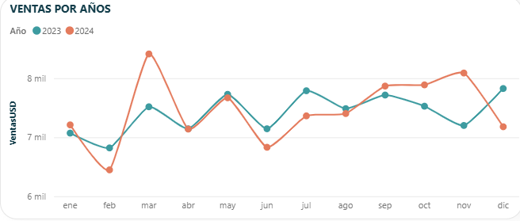
- **Número de ordenes por turno:** Ilustra el número de ordenes recibidas de acuerdo a los turnos mañana, tarde y noche.
        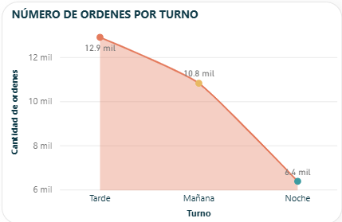
- **Top 3 productos y % de reseñas positas:** Destaca los 3 productos más vendidos, que gracias a los filtros podemos identificar los productos más vendidos por sucursal o por tipo de membresía. Por otro lado el % de reseñas positivas nos muestra el desempeño que tienen las sucursales o los productos de acuerdo a las reviews de los clientes.
       
     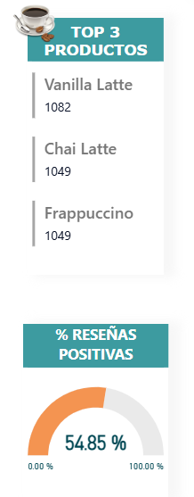

## 🖼️ Vista Previa del Dashboard
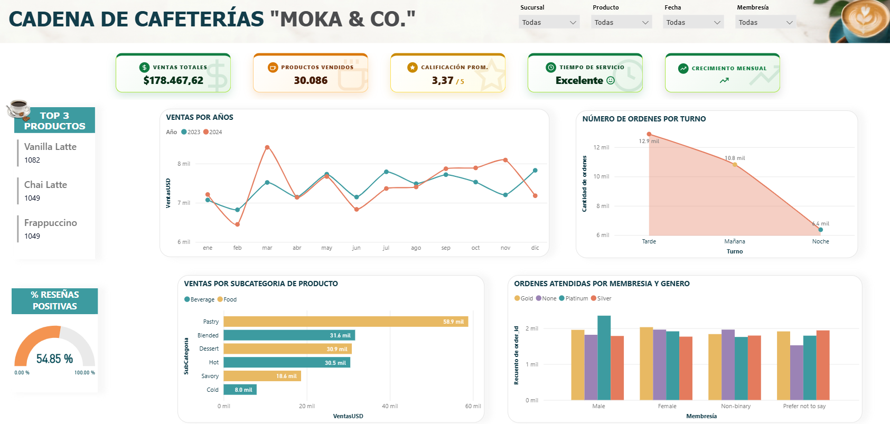

**Vista dinámica:** Al seleccionar una sucursal y un mes de ventas podemos el cambio dinámico del dashboard.
    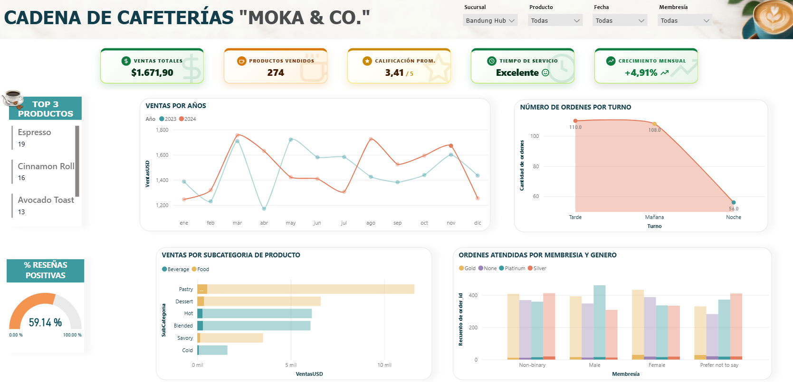

## 💡 Conclusiones y Hallazgos
- Insight 1: A pesar de lograr un tiempo de servicio evaluado como "Excelente", la calificación promedio general se sitúa en 3.37 sobre 5, alcanzando únicamente un 54.85% de reseñas positivas. Este contraste puede indicar que la velocidad de atención no está garantizando la satisfacción total del cliente, apuntando a posibles problemas de calidad en los productos o en el servicio al cliente.
- Insight 2: La distribución de órdenes atendidas revela una proporción considerable de transacciones realizadas por clientes sin ninguna membresía activa (etiquetados como "None") en todos los géneros. Esto evidencia un alto margen para diseñar estrategias de conversión hacia los programas Silver, Gold y Platinum.
- Insight 3: Se observa un comportamiento por horarios donde el turno de la tarde es el pico de mayor actividad para la cadena, acumulando 12.9 mil órdenes, seguido por la mañana con 10.8 mil. El turno nocturno presenta la menor afluencia operativa con 6.4 mil órdenes.

